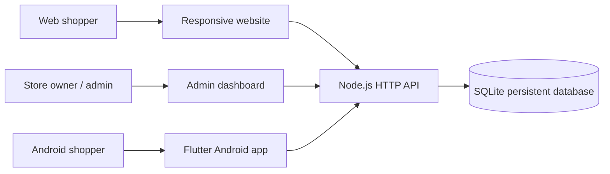

# IwacuMall — Architecture & API

## Component diagram



**Single source of truth:** catalog/price, order total, stock and status are always computed and persisted in the backend. The clients cannot choose a different total.

**Technology:** HTML5/CSS3/modern ES modules (website), Flutter/Dart (Android), Node.js 22 built-in HTTP server, built-in `node:sqlite` (persistent database), salted scrypt for passwords, random bearer sessions.

## Data model

```text
users(id, name, email, password_hash, role, created_at)
sessions(token_hash, user_id, expires_at)
categories(id, name, slug)
products(id, name, slug, description, price, stock, category_id,
         image_url, featured, active, created_at, updated_at)
orders(id, user_id, customer_name, phone, address, city, note,
       subtotal, delivery_fee, total, payment_method, status, created_at)
order_items(id, order_id, product_id, product_name, unit_price, quantity)
```

All money is stored as **whole Rwandan francs (integers)**. The shipped version accepts `CASH_ON_DELIVERY` only; no fake checkout gateway is present.

## API reference (prefix `/api`)

| HTTP | Endpoint | Access | Purpose |
|---|---|---|---|
| GET | `/health` | Public | Health check |
| GET | `/config` | Public | Store configuration and payment policy |
| GET | `/categories` | Public | Browse categories |
| GET | `/products?search=&category=&featured=1` | Public | Catalog filtering |
| GET | `/products/:id` | Public | Product details |
| POST | `/auth/register` | Public | Customer signup |
| POST | `/auth/login` | Public | Sign in and get token |
| POST | `/auth/logout` | Signed in | Revoke token |
| GET | `/me` | Signed in | Profile |
| GET | `/me/orders` | Signed in | Personal order history |
| POST | `/orders` | Signed in | Create order and subtract inventory atomically |
| GET | `/orders/:id` | Owner/Admin | View order details |
| GET | `/admin/stats` | Admin | KPI counts and delivered-order value |
| GET | `/admin/orders` | Admin | List orders |
| PATCH | `/admin/orders/:id/status` | Admin | Change state / restore inventory on cancellation |
| GET | `/admin/products` | Admin | All products, including hidden |
| POST | `/admin/products` | Admin | Add product |
| PATCH | `/admin/products/:id` | Admin | Change stock / details |
| DELETE | `/admin/products/:id` | Admin | Soft-hide product |
| POST | `/admin/categories` | Admin | Add a category |

Authentication: `Authorization: Bearer <token>`.

Example request:

```http
POST /api/orders HTTP/1.1
Authorization: Bearer <token>
Content-Type: application/json

{
  "customerName": "Example Customer",
  "phone": "0788000000",
  "city": "Kigali",
  "address": "Kicukiro, landmark near the market",
  "items": [{ "productId": "UUID_FROM_CATALOG", "quantity": 2 }]
}
```

**Order status graph:** `PLACED → CONFIRMED → PACKING → OUT_FOR_DELIVERY → DELIVERED`, with cancellation possible from any pre-delivery stage. Cancellation restores stock. Delivered/cancelled orders cannot be altered through the API.

**Design trade-off:** This first delivery favors an easily runnable, zero-`npm install` Node web backend on a single server. For larger commerce operations, review migration to managed PostgreSQL with migrations, observability, background jobs, backups, and an appropriate order/payment event model.
