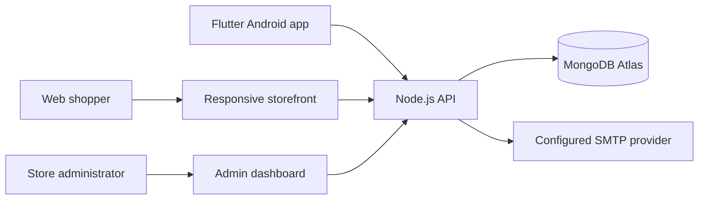

# IwacuMall architecture and API

## Components



The API is the source of truth for prices, stock, invoices, payment status and order fulfilment. A one-minute background sweep expires overdue unpaid invoices transactionally, restores their reserved stock and writes an audit event. Browser authentication uses HttpOnly/SameSite cookies with a CSRF token. Native requests send an explicit bearer token; the app stores it with OS secure storage. Administrator APIs require an authenticated administrator session. MFA is optional; accounts that enable it must provide a valid authenticator or recovery code at login.

## MongoDB collections

- `users`: account profile, scrypt password hash, email verification/reset state, role and MFA flag.
- `sessions`: hashed opaque session token and expiry.
- `categories`, `products`: catalogue and integer RWF prices/stock.
- `orders`: customer/order snapshot, invoice totals, payment method instructions snapshot, payment state and fulfilment state.
- `paymentMethods`: owner-configured manual payment instructions.
- `storeSettings`: singleton for public store contact details, delivery fee, tax rate and invoice deadline.
- `auditLog`: administrative payment, cancellation, fulfilment and settings events.
- `adminTotpSecrets`: encrypted TOTP secrets and pending setup state.

Order stock reservation, payment-state changes and their audit records use Mongo transactions. Configure Atlas or a MongoDB replica set; standalone MongoDB does not support these transactions.

## API reference (prefix `/api`)

| Method | Endpoint | Access | Purpose |
|---|---|---|---|
| GET | `/health` | Public | API and database readiness |
| GET | `/config` | Public | Store contact, checkout settings and enabled payment methods |
| GET | `/categories`, `/products` | Public | Catalogue browsing |
| POST | `/auth/register`, `/auth/login` | Public | Create account or sign in |
| POST | `/auth/forgot-password`, `/auth/reset-password` | Public | Password recovery |
| GET | `/auth/verify-email` | Email token | Verify an email address |
| POST | `/auth/resend-verification` | Signed in | Resend verification message |
| POST | `/auth/logout` | Signed in | Revoke current session |
| GET | `/me`, `/me/orders` | Signed in | Account and order history |
| POST | `/orders` | Signed in | Create invoice and reserve stock |
| GET | `/orders/:id` | Owner or admin | Read order/invoice details |
| POST | `/admin/mfa/setup`, `/admin/mfa/verify` | Admin session | Enroll administrator authenticator MFA |
| GET/PATCH | `/admin/settings` | Admin session | Read/update store settings |
| GET/POST/PATCH/DELETE | `/admin/payment-methods` | Admin session | Manage manual payment instructions |
| GET/PATCH/POST/DELETE | `/admin/products` | Admin session | Manage catalogue and inventory |
| POST | `/admin/categories` | Admin session | Add catalogue category |
| GET/POST/PATCH | `/admin/orders` | Admin session | List orders, confirm payment, record refunds, update fulfilment |

All order prices and totals are recalculated by the server. `POST /orders` requires `paymentMethodId`, customer contact/address fields and `{ productId, quantity }` lines. Payment instructions are snapshotted into the invoice so later method edits do not alter existing invoices.

## Order flow

```text
PLACED → CONFIRMED → PACKING → OUT_FOR_DELIVERY → DELIVERED
   └─────────────── CANCELLED
```

An administrator confirms manual payment before fulfilment can advance. Cancellation restores reserved stock exactly once. Expired unpaid orders are voided by the server’s expiry process.

## Operational notes

- Store fees, tax and invoice deadline are saved in MongoDB through the dashboard; environment values seed the initial defaults.
- Authentication throttling uses HMACed fixed-window counters in MongoDB with TTL cleanup, so API instances share limits without storing raw client IPs.
- TOTP secrets are encrypted using `COOKIE_SECRET`; rotating that secret makes existing stored authenticator secrets unreadable. Plan MFA recovery before rotation.
- The SQLite migration is optional for existing legacy data and requires a dry-run, verified backup and review before a write.
